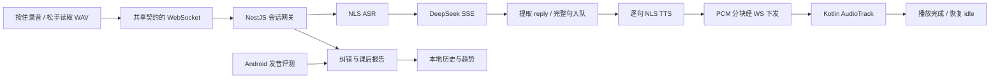

# 项目档案 · AIRealTalk AI 英语口语对练 App

> 用途：围绕当前简历的 **四点主要实现**，准备前端 / 全栈 / AI 应用面试。
> 核对日期：**2026-10-20（Asia/Shanghai）**；Git 基线：`ea64aa9`，以本次读取的当前工作区为准，包含未提交的首句开声改动。
> 证据口径：源码说明“现在写了什么”，提交差异说明“实现怎样演进”，实际执行记录说明“验证到了哪里”。不补写延迟收益、用户规模或没有证据的线上事故。
> 结构参照：Fitness 项目的 `INTERVIEW-PROJECT-ARCHIVE.md`；内容按本项目代码独立核对。

## 阅读方式

先讲熟每点的“20～30 秒回答”，再根据追问展开。四点统一采用：**事实卡 → 提问方向地图 → 逐问预答 → 准备动作清单 → 踩坑记录 → 实现细节 → 源码入口**。

1. [实时语音链路](#point-1)：Kotlin PCM 播放、四状态协作、录音与播放生命周期。
2. [LLM 首句开声](#point-2)：DeepSeek SSE、未闭合 JSON 提取、切句与串行 TTS。
3. [跨端协议治理](#point-3)：共享 Zod、19 个 WS 事件、编译期类型与运行时校验。
4. [异常恢复](#point-4)：指数退避、心跳 RTT、35 秒等待兜底、重试和权限引导。

故事标签分三类：**提交可核实**可对照历史差异；**工作区改动可核实**尚未提交；**实现型踩坑**有源码依据，但不等同于已证实发生过某次故障。最后一类可讲“这里需要处理的问题是……”，不要自行添加用户投诉、排查天数或故障规模。

## 项目描述与当前实现

**简历描述**：AI 英语口语对练 App，个人全栈项目，简历时间为 **2026.06—2026.06**。用户在多个场景中与 AI 角色进行语音对话，获得提示纠错、课后详析报告与练习趋势图。

**面试开场，约 40 秒**：

> 这是我做的一个 AI 英语口语对练 App，移动端用 React Native，后端用 NestJS。用户可以选择面试、点餐和会议场景，按住说话，松手后由后端做识别、生成回复和语音合成，练完能看纠错报告和历史趋势。我主要做了四块：Android 原生 PCM 播放与录音状态协调、模型还没生成完整 JSON 时先提取完整句送去合成、前后端共享事件契约，以及断线和超时后的可恢复交互。其中最值得展开的是首句开声，它把模型生成后续内容和前句语音合成重叠起来了。

### 技术栈核对

| 层次 | 当前仓库口径 | 主要证据 |
| --- | --- | --- |
| 移动端 | TypeScript、bare React Native 0.85.3、React 19.2.3、Zustand 5；Android 原生 Kotlin 模块 | [mobile/package.json](../mobile/package.json) |
| 后端 | NestJS 11、`@nestjs/platform-ws` 与 `ws`、Axios；会话保存在进程内 | [backend/package.json](../backend/package.json)、[会话网关](../backend/src/voice-session.gateway.ts) |
| 共享协议 | pnpm workspace、`@airealtalk/shared`、Zod 3 | [shared/package.json](../packages/shared/package.json)、[事件契约](../packages/shared/src/ws-events.ts) |
| 模型 | DeepSeek，当前请求中的模型标识为 `deepseek-chat`，SSE 流式读取 | [模型服务](../backend/src/llm/deepseek-llm.service.ts) |
| 语音 | 阿里云 NLS ASR / TTS；Android AudioTrack 播放 PCM | [ASR](../backend/src/asr/aliyun-asr.service.ts)、[TTS](../backend/src/tts/aliyun-tts.service.ts) |
| 发音评测 | 有 Mock 和 Android 原生 ssapi / SingEngine 接入路径；真实模式由配置、授权和原生库共同决定 | [端侧评测](../mobile/src/services/pronunciation.ts)、[评测 ADR](./adr/0001-pronunciation-on-android-client.md) |
| 历史与图表 | AsyncStorage 存摘要和完整报告；SVG 展示分数趋势 | [历史存储](../mobile/src/stores/history-store.ts)、[趋势图](../mobile/src/components/ScoreTrendChart.tsx) |

版本是包清单中的声明，不表示本次检查了线上环境或供应商当前可用模型。项目没有在这条会话链路中使用数据库、Redis 或消息队列。

### 四点在系统中的位置



这是 **Push-to-Talk 轮流对话**。当前录音上传、ASR、模型、TTS、播放各层的“流式程度”不同，不能一句话概括成全双工、端到端实时语音系统。

## 简历四点与核对结论

| 简历原句 | 核对结论与口径校准 |
| --- | --- |
| **① 实时语音链路**：自研 Kotlin 原生模块流式播放后端 PCM，配合 zustand 四态状态机消除录音/播放竞态。 | 原生播放与四阶段协作已写入代码；“消除”过强。Zustand 只存阶段，互斥还依靠 UI 禁用、录音 ref、服务端标志和原生完成回调；没有形式化转移约束或完整竞态测试。 |
| **② LLM 首句开声**：自研增量 JSON 解析器从 DeepSeek SSE 未闭合响应中切句送 TTS，AI 首句合成即播放。 | 当前工作区有 SSE + `StreamingJsonReplyExtractor` + 串行 TTS 链；属于未提交改动。准确说法是“针对 reply 字段的增量提取器”，不是通用 JSON 流解析器。TTS 单句仍先取完整 WAV，再拆 PCM 下发。 |
| **③ 跨端协议治理**：Zod 在 monorepo shared 包统一 19 个 WS 事件，前后端共享类型与运行时校验，消除协议漂移。 | 当前工作区 19 个事件成立：客户端 7 个、服务端 12 个。接收边界均有 Zod；事件映射与 schema 仍有人工重复维护，服务端发送包装也有类型关联变弱的问题，应说“降低协议漂移风险”。 |
| **④ 异常恢复**：WS 指数退避重连 + 心跳 RTT 监控 + 35s 超时分级重试 + 麦克风权限引导，弱网与权限异常不白屏。 | 退避、RTT 计算、35s processing 兜底、错误提示和权限引导存在；RTT 未接入当前对话页显示，也未触发断线判定。35s 后让用户重新录音，不会自动重放原请求；“不白屏”没有完整真机故障矩阵验证。 |

**更稳妥的简历措辞备选**：

- 实时语音链路：自研 Kotlin AudioTrack 模块播放后端 PCM 分块，配合 Zustand 四阶段与录音互斥控制，协调录音、处理和播放生命周期。
- LLM 首句开声：从 DeepSeek SSE 增量提取未闭合 JSON 的 reply 字段，完整句串行送入 TTS，首句合成后即可播放。
- 跨端协议治理：在 Monorepo shared 包集中维护 19 个 WS 事件，前后端共享类型并校验接收消息，降低协议漂移风险。
- 异常恢复：实现 WS 指数退避重连、心跳 RTT 计算、35s 等待超时兜底与手动重试，并提供麦克风权限引导。

## 面试深挖预案

| 简历点 | 主问题 | 第一层回答 | 继续准备 | 首选故事 |
| --- | --- | --- | --- | --- |
| ① 语音链路 | 音频发完为什么不能马上开放录音？ | 网络发完不等于手机播完，要等本地播放器收尾 | PCM 参数、初始化先后、重复 stop、状态分层 | 录音中返回页面的生命周期修复 |
| ② 首句开声 | JSON 没结束为什么就能播放？ | 只提取 reply 已完成的句子，完整结构最后解析 | SSE 半包、转义、句子顺序、重试隔离 | 全文等待改为逐句流水处理 |
| ③ 共享契约 | TS 已有类型，为什么还用 Zod？ | 网络输入不受 TS 保证，接收时还要校验 | 事件清单、类型映射、版本兼容、验证边界 | 新增 llm:reply 时同步两端 |
| ④ 异常恢复 | 重连后能接着聊吗？ | 连接能恢复，但当前会话重新创建 | 心跳与 RTT、35s 含义、迟到响应、权限拒绝 | 避免一直等待并给出明确操作入口 |

统一讲述顺序：**用户遇到什么 → 原实现哪里不够 → 怎样处理 → 用什么验证 → 还有什么边界**。

<a id="point-1"></a>

## 要点① 深挖手册 · 实时语音链路

> 简历原句：自研 Kotlin 原生模块流式播放后端 PCM，配合 zustand 四态状态机消除录音/播放竞态。
> 大白话：用户和 AI 轮流讲话，音频到手机后按顺序播放，播完再让用户继续。

### 20～30 秒回答

> 我在 Android 写了一个 Kotlin 模块，用 AudioTrack 接收并播放后端发来的 PCM。页面用 idle、listening、processing、speaking 四个阶段控制录音入口，录音 hook 再用 ref 防止重复启动和停止。后端发完音频后，手机还要等播放器完成收尾，才恢复可录音状态。

### 事实卡（现在做到了什么）

| 环节 | 当前实现 | 回答时注意 |
| --- | --- | --- |
| 录音 | 16kHz、单声道、16-bit；`react-native-audio-record` 生成 WAV | 录音结束后才读文件并分块上传，不是边录边传 |
| 文件保留 | 每轮复制成独立缓存 WAV，供发音评测使用 | 不能让下一轮录音覆盖上一轮待评测文件 |
| 识别 | 后端拼接上传数据，NLS HTTP 请求返回识别结果 | 当前 `partials: [final]`，不是持续实时 partial |
| 语音合成 | 一次文本请求取完整 WAV，去头后拆成默认 6400 字节 PCM 块 | WAV 去头仅按常见 44 字节布局处理，不是通用 RIFF parser |
| 播放 | Kotlin `AudioTrack.MODE_STREAM`，Base64 解码后循环 write | 原生模块是自行实现的桥接与播放控制，语音合成本身来自云服务 |
| 初始化 | hook 保存 `streamReadyRef`；chunk 和 end 等待初始化 Promise | 解决 start 尚未完成就写音频的先后问题 |
| 播放收尾 | 根据已写帧数减播放头估算剩余时间，延迟后 resolve end Promise | 不是硬件精确结束通知，不保证所有设备零误差 |
| 页面阶段 | Zustand 存四个阶段，processing / speaking 时禁用按住说话 | store 本身没有转移表，`setPhase` 可直接赋值 |
| 录音互斥 | `isRecordingRef` 与 `isStoppingRef` 防止重复 start / stop | 不能由此推导所有异步竞态都已解决 |
| 服务端保护 | 开场完成、isSpeaking、isRecording 等标志检查 | 服务端没有收到“手机实际播完”的确认事件 |

### 提问方向地图

| 方向 | 面试官想知道什么 | 对应问题 |
| --- | --- | --- |
| A. 选型 | 为什么需要原生模块，为什么选 PCM | A1～A2 |
| B. 音频链路 | 参数、分块、初始化和收尾 | B1～B4 |
| C. 状态与生命周期 | 四阶段和互斥怎样协作 | C1～C4 |
| D. 验证与扩展 | 怎样证明，如何支持打断 | D1～D2 |

### 逐问预答

**A1. 为什么自己写 Kotlin 模块？**

> 后端给的是 PCM 分块，我需要 start、写 chunk、结束并等待播放完成、主动 stop 这几个明确操作。用 AudioTrack 封装后，JS 负责业务状态，原生层负责播放和资源释放。这里的自研范围是原生桥接与控制逻辑，不是音频驱动或语音合成算法。

**A2. 为什么传 PCM，不直接传一个 MP3 文件？**

> PCM 可以按固定采样格式直接写入 AudioTrack，省掉文件播放和压缩解码流程，适合当前分块下发的实现。代价是体积较大，Base64 还增加传输开销；当前也没有做编码方案的性能对比。

**B1. 16kHz、单声道、16-bit 分别是什么意思？**

> 每秒 16000 个采样点，一个声道，每个采样点 2 字节，所以原始 PCM 每秒约 32000 字节。默认 6400 字节块约含 200ms 音频，但这只是音频时长，不代表每 200ms 发一次，也不代表首句延迟是 200ms。

**B2. 上传给后端的是 PCM 吗？**

> 当前移动端停止录音后读取的是 WAV 文件，再拆 Base64 发送。后端变量虽然叫 pcmBuffer，但内容可能带 WAV 头，ASR 适配器会检查；不能仅凭变量名说上传的是裸 PCM。下行 TTS 才会去掉 WAV 头，把 PCM 交给播放器。

**B3. tts:start 后马上收到 chunk，播放器还没初始化怎么办？**

> `onTtsStart` 把 stop 旧播放器、start 新播放器这两个动作包成 Promise 存下来。`onTtsChunk` 和 `onTtsEnd` 先等这个 Promise，再调用原生层，避免初始化尚未完成就写入。

**B4. 收到 tts:end 就表示手机播完了吗？**

> 不表示。它只说明后端不再发送这一段流的数据。原生层记下总帧数，减去播放头位置，再按采样率估算剩余时间，加上缓冲后结束。hook 等 endStream 完成才把页面恢复 idle。这个实现是估算收尾，后续可以改成更可靠的播放完成检测。

**C1. 四个状态分别由什么触发？**

> 初始 idle；录音成功启动后 listening；松手进入 processing；收到 speaking 阶段或 tts:start 后 speaking；本地播放完成后回 idle。失败和 35 秒 processing 超时也会重置，所以它是业务阶段协作，不是只有一条不可逆的正常路径。

**C2. Zustand 为什么还不够，要用 ref？**

> Zustand 让页面共享和展示业务阶段；ref 是录音 hook 内立即读写的操作标志。两个 stop 在异步操作完成前到达时，后一个可以看到 isStoppingRef 并退出，不需要等下一次渲染。两者解决的问题不同。

**C3. 这个状态机真的消除了全部竞态吗？**

> 没有这样的保证。它约束正常交互，同时用 ref 和服务端标志减少重复操作，但没有统一的合法转移函数。比如旧请求超时后又返回、异常时播放器仍有音频，都还需要轮次标识、取消和更完整的清理来处理。

**C4. 正在录音时退出页面怎么处理？**

> 返回入口先调用 abortRecording；hook 卸载时也会清理。abort 会检查是否录音、是否已经停止中，再调用原生 stop，并在 finally 清掉标志。`40be8d1` 的差异能核实这组保护。当前不能把“调用过清理”讲成所有快速退出时序都已经真机验证。

**D1. 怎样验证录音播放不会互相打架？**

> 真机分别试开场白未结束时按住、播放末尾抢按、快速按下松开、录音中返回、服务端报错时仍有缓存音频。要观察按钮、业务阶段和原生资源是否一致。本次核对了实现和历史差异，没有运行这组真机测试。

**D2. 如果要支持用户打断 AI，怎么改？**

> 需要一次 turnId 贯穿生成、合成和播放；用户打断时停止播放器、取消后端生成和排队合成，并忽略旧轮次迟到音频。现在通过禁止 speaking 时录音实现轮流说话，尚未实现 barge-in，也没有回声消除链路。

### 准备动作清单

1. 画出“WAV 上传 → ASR → LLM → WAV 合成 → PCM 下发 → AudioTrack”的格式变化。
2. 能区分网络发送完成、本地缓存写入完成、扬声器播放完成。
3. 讲清 Zustand 阶段、录音 ref、服务端标志各自负责什么。
4. 用 `40be8d1` 的 diff 讲一次录音退出清理，不虚构设备和事故细节。

### 踩坑记录（问题 → 原因 → 修改 → 验证）

#### 问题 1：录音时返回页面，停止与清理可能重复发生（提交可核实）

**问题与原因**：松手、页面返回、组件卸载都可能触及同一原生录音资源；只判断“开始过录音”不足以协调正在进行的 stop。

**修改**：`40be8d1` 新增 isStoppingRef、abortRecording 和卸载清理，并保护 start / stop。每轮 WAV 另存独立路径，为后续逐句评测保留原始录音。

**40 秒话术**：

> 音频模块的难点不只是录下来，还有退出时谁来停止。松手和返回都可能触发清理，所以我把“正在录音”和“正在停止”分开标记，让重复操作直接返回，并在页面退出和 hook 卸载时清理。这样业务页面退出和原生资源释放才有明确的衔接。

**验证**：提交与当前代码已核对；本次未运行 Android 复现，不能补写崩溃率变化。

#### 问题 2：后端已经发完，手机还有尾音（实现型踩坑）

**原因**：发送进度和播放进度不同。直接在 tts:end 切回 idle，可能让用户在 AI 尾音期间开始录音。

**处理**：endStream 等原生估算的剩余播放时间结束后 resolve，再触发 onPlaybackComplete。最低等待为 80ms 再加 120ms 缓冲，不是固定 200ms 就能代表任何音频的结束时间。

**验证**：核对了帧计数、播放头和回调链；未实测尾音截断或跨设备误差。

### 实现细节：一轮语音怎样收尾

```text
按住 → 检查连接、权限和录音 ref → audio:start → 原生录音
松手 → listening 转 processing → stop → 保存独立 WAV
     → Base64 分块 audio:chunk → audio:end
后端 → ASR → LLM / TTS → tts:start、多个 tts:chunk、tts:end
手机 → 等 start Promise → AudioTrack 写 PCM → endStream 等待
     → onPlaybackComplete → 两处本地状态恢复 idle
```

正常路径防止录放重叠依靠客户端最后一步。服务端 isSpeaking 在发送结束后就会清零，不能拿它证明手机已经实际播完。

### 源码与演示入口

- [TtsPlayerModule.kt](../mobile/android/app/src/main/java/com/airealtalkmobile/TtsPlayerModule.kt)：AudioTrack、写入、帧数和释放。
- [useTtsPlayer.ts](../mobile/src/hooks/useTtsPlayer.ts)：初始化等待与播放结束回调。
- [useAudioRecorder.ts](../mobile/src/hooks/useAudioRecorder.ts)、[session-store.ts](../mobile/src/stores/session-store.ts)、[ConversationScreen.tsx](../mobile/src/screens/ConversationScreen.tsx)：录音保护与四阶段。
- [audio-chunker.ts](../backend/src/tts/audio-chunker.ts)、[aliyun-asr.service.ts](../backend/src/asr/aliyun-asr.service.ts)：格式转换与 ASR。

<a id="point-2"></a>

## 要点② 深挖手册 · LLM 首句开声

> 简历原句：自研增量 JSON 解析器从 DeepSeek SSE 未闭合响应中切句送 TTS，AI 首句合成即播放。
> 大白话：AI 的第一句话已经写完，就先去合成；不用等纠错信息和整段 JSON 全部生成。

### 20～30 秒回答

> 模型返回的 JSON 同时包含回复和纠错，等整个对象生成完再合成会增加等待。我先从 SSE 取内容增量，累计后只提取 reply 字符串，把已经完整的句子放进串行 TTS 链。第一句合成结束就能下发 PCM，模型可以继续生成后面的内容，最后再解析完整结构。

### 事实卡（现在做到了什么）

| 环节 | 当前实现 | 回答时注意 |
| --- | --- | --- |
| 开关 | `USE_STREAMING_PIPELINE !== 'false'` 默认启用流式编排 | 未提交工作区功能，不代表已发布版本 |
| 模型读取 | Axios `responseType: 'stream'`；请求 `stream: true` | 移动端仍用 WS，SSE 在后端与模型之间 |
| SSE 拆包 | lineBuffer 累计，以换行分割，读取 data 行中的 delta.content | 针对当前响应格式，不是完整 SSE 标准实现 |
| reply 提取 | 累计 JSON 文本，找到 `"reply": "` 后扫描字符串 | 不等待外层对象闭合；不是完整 JSON 状态机 |
| 转义 | 处理换行、制表、回车、引号和反斜杠等常见转义 | 没有完整 Unicode 转义和所有跨 chunk 边界支持 |
| 切句 | `. ! ?` 后出现空白或当前字符串结束时，视为完整句 | 缩写、小数或后续继续补字可能误切 |
| 去重 | emittedCharIndex 记录已消费的 reply 字符位置 | 是字符串游标，不是网络事件序号 |
| 顺序 | `ttsChain = ttsChain.then(...)` 串行合成句子 | 不会同时发起所有句子的 TTS 请求 |
| 尾句 | LLM 结束时 flush 尚无标点的剩余文本 | 无句子播放时可回退完整 reply 播放 |
| 最终结果 | 完整响应解析后记录回复、纠错；等待 TTS 链后发 llm:reply 和 tts:end | 当前并不是文字 token 实时展示；最终文字可能晚于语音开始 |
| TTS | 每句完整 WAV 返回后分块下发 | 并未消费供应商音频响应体的实时网络 chunk |
| 验证 | 有 5 个切句 / 提取单测用例定义 | 本次 Jest 初始化失败，不能说这些测试已通过 |

### 提问方向地图

| 方向 | 面试官想知道什么 | 对应问题 |
| --- | --- | --- |
| A. 动机 | 优化哪段等待，SSE 放在哪里 | A1～A2 |
| B. 解析 | 两层 JSON、半包、转义、切句 | B1～B4 |
| C. 编排 | 顺序、尾句、失败和重试 | C1～C4 |
| D. 效果 | 怎样量化，接下来优先补什么 | D1～D2 |

### 逐问预答

**A1. 首句开声到底优化了什么？**

> 优化的是从用户说完到听到 AI 首句的等待，主要减少“等待模型生成剩余回复和结构字段”的部分。它没有让 ASR 自动更快，也没有证明整个回答总耗时下降。目前没有测量前后耗时，不能给出百分比。

**A2. 为什么手机用 WS，模型又用 SSE？**

> 手机既要上传音频和控制事件，也要收转写、提示和音频，统一 WS 便于编排；模型接口通过 SSE 返回生成增量，后端负责适配。手机不直连模型，也不解析供应商 SSE。

**B1. JSON 没闭合，JSON.parse 怎么工作？**

> 这里有两层 JSON。每条完整 SSE data 行是供应商的事件 JSON，可以先解析它取得 delta.content；这些 content 拼起来才是业务 JSON。业务对象可能还没闭合，我用专门的 reply 字符串提取器读已有前缀，最后才解析完整业务对象。

**B2. 为什么不能直接对每个 chunk 用正则切句？**

> 一个 chunk 可能是半个字段名、半句或几句。如果只处理当前 chunk，会丢上下文或重复句子。当前先累计到 jsonBuffer，每次提取已有 reply，再从 emittedCharIndex 往后取新完成的句子。

**B3. 你的提取器是严格增量 O(n) 解析吗？**

> 不是。它增量接收输入，但每次会重新扫描累计字符串，数据很多、chunk 很碎时可能有重复扫描开销。准确说是面向 reply 字段的增量提取。若扩展成长输出，可改成维护字段、字符串、转义状态和扫描游标的状态机。

**B4. 转义、缩写和小数都支持吗？**

> 只处理了常见转义，切句也是简单标点规则。Unicode 转义、反斜杠正好落在 chunk 尾部、`Dr.` 或小数点都需要更细的处理，现有测试没有覆盖这些边界。不能把它描述成支持任意 JSON 和任意英文分句。

**C1. 多句话合成速度不同，会不会后一句先播？**

> 网关用 Promise 链逐句调用 synthesize，上一句合成和发送结束后再处理下一句，因此当前不需要对并发合成结果重新排序。代价是后一句必须等待前一句，句间停顿仍需要实测。

**C2. 最后一句没有句号怎么办？**

> SSE 正常结束并得到最终响应后，调用 flushRemainingSentence，把尚未消费的尾部文本送去合成。如果提取器一直没有启动播放，则回退用最终解析的 reply 做播放。

**C3. 已经播了第一句，后面 JSON 不合法怎么办？**

> 完整解析有 Zod 校验和有限降级，但已播放的声音无法撤回。当前也没有统一的播放取消与重试轮次隔离；尤其模型重试仍复用同一内容回调，可能把多次尝试送进同一个提取器。因此这是需要补齐的失败边界，不能保证播放内容始终与最终对象一致。

**C4. 模型请求失败会自动重试三次吗？**

> 最多三次是空回复或无法解析结果的重试逻辑，前两次带 JSON mode，第三次取消该参数。网络错误和超时会由 callApi 抛出，并不会自动继续这三次循环。提取到了合法 reply 时，解析器还可能提前降级为空 hints / corrections 返回。

**D1. 怎样证明第一句确实更快？**

> 用同一设备、场景和相近输入，对开关前后记录松手、ASR 完成、首个内容增量、首句入队、首个 PCM 到达、设备可听开声的时间。分别统计首句等待和整轮结束，报告样本和分布。当前只有机制依据，没有这组测量结果。

**D2. 现在最该补什么？**

> 优先补跨 chunk 转义、句末标点后继续补字、模型第二次尝试以及 TTS 中途失败的测试，再让 turnId 和取消信号贯穿提取器与播放器。还要处理 UTF-8 字符跨网络 Buffer 的解码，当前每块直接 toString 不能保证这种边界完整。

### 准备动作清单

1. 用“两层 JSON”解释 SSE 事件完整、业务对象未闭合为什么不矛盾。
2. 手算一组片段：`{"reply":"Hello.` → ` How are you?` → `","hints":[]...`。
3. 区分“模型分段生成”“按句合成”“PCM 分块播放”。
4. 讲收益先说明等待如何重叠，测量完成前不报毫秒值。

### 踩坑记录（问题 → 原因 → 修改 → 验证）

#### 问题 1：回复首句已生成，还在等整个结构化结果（工作区改动可核实）

**原实现**：对照 `ea64aa9`，模型请求等待完整响应；业务拿到 reply 后才进入后续播放。

**修改**：当前工作区增加 SSE 内容回调、StreamingJsonReplyExtractor 和网关逐句 TTS 链；`USE_STREAMING_PIPELINE=false` 可切回完整回复后编排。注意关闭该开关只改变编排方式，当前模型服务内部仍使用 SSE 收完全文。

**40 秒话术**：

> 模型输出不仅有回复，还有提示和纠错；等全部结束才合成，会把不需要朗读的字段也放进首句等待时间。我把生成和合成拆成流水过程，只要 reply 里形成一句，就先放进顺序队列，后面的文本继续生成。这样从机制上减少了首句等待，但精确收益还需要统一设备和输入做测量。

**验证**：核对了未提交差异和 5 个相关单测定义；Jest 本次未成功初始化，尚无通过记录，也未调用真实模型验收。

#### 问题 2：改成先播放后，文字事件不能再依赖开头的完整 reply（工作区改动可核实）

**原因**：流式路径的 tts:start 在完整回复之前发送，此时 reply 传空串。旧的“开始播放时顺便显示全文”不再适用。

**修改**：共享契约新增 llm:reply；移动端单独接收完整文字并避免重复插入。当前这个事件在 TTS 链结束后发出，不能说实现了逐 token 字幕。

**验证**：事件 schema、网关发送和页面消费三处均已核对，尚未做真机时序测试。

### 实现细节：首句和后续文本怎样重叠

```text
DeepSeek: SSE delta → 业务 JSON 前缀 → 第一完整句 → 后续句 / hints / corrections
                                          ↓              ↓
TTS 链:                              合成第 1 句 → 合成第 2 句 → ...
                                          ↓              ↓
Mobile:                             收 PCM / 播放 → 继续写 PCM → 等待播完

模型正常结束 → flush 尾句 → 完整结果解析 / 保存 → 等 TTS 链
            → llm:reply → tts:end
```

队列先发 tts:start 再请求首句合成，所以进入 speaking 并不意味着已经有声音。该时刻也会结束页面的 processing 超时计时，后续 speaking 卡住不受 35s 规则覆盖。

### 源码与演示入口

- [deepseek-llm.service.ts](../backend/src/llm/deepseek-llm.service.ts)：SSE 行缓冲与尝试策略。
- [reply-sentences.ts](../backend/src/llm/reply-sentences.ts)、[对应测试](../backend/src/llm/reply-sentences.spec.ts)：reply 提取、切句、游标、尾句。
- [voice-session.gateway.ts](../backend/src/voice-session.gateway.ts)：runLlmAndTtsStreaming、Promise 合成链和 llm:reply。
- [llm-response.parser.ts](../backend/src/llm/llm-response.parser.ts)、[aliyun-tts.service.ts](../backend/src/tts/aliyun-tts.service.ts)：最终结构解析与单句 WAV 合成。

<a id="point-3"></a>

## 要点③ 深挖手册 · 跨端协议治理

> 简历原句：Zod 在 monorepo shared 包统一 19 个 WS 事件，前后端共享类型与运行时校验，消除协议漂移。
> 大白话：手机和后端用同一份消息约定，消息进门时检查，减少一边改了另一边没改的问题。

### 20～30 秒回答

> 我把 WS 事件名、payload 类型和 Zod schema 放在 shared 包里，前后端都引用它。当前有 7 个客户端事件和 12 个服务端事件。TypeScript 帮助开发时发现字段错误，Zod 在两端接收网络消息时检查实际数据；新增事件时再同步处理分支，降低协议不一致风险。

### 事实卡（现在做到了什么）

| 环节 | 当前实现 | 回答时注意 |
| --- | --- | --- |
| 常量 | WS_EVENTS 集中定义 19 个字符串 | 当前工作区新增 llm:reply，不能把此数字回套到旧提交 |
| 发送类型 | WsEventMap、方向类型、泛型 createClientEvent / createServerEvent | 工厂只组装对象，不执行运行时 parse |
| 接收类型 | `z.infer` 从 discriminatedUnion 得到事件联合 | 接收联合可按 type 收窄 payload |
| 后端入口 | JSON.parse → ClientWsEventSchema.parse → dispatch | 校验异常会尝试返回 INVALID_MESSAGE |
| 客户端入口 | JSON.parse → ServerWsEventSchema.parse → onServerEvent | 当前 catch 静默忽略，缺少校验失败可观测性 |
| 后端分发 | switch + never 穷尽检查 | 客户端 default 忽略，不具备同样的穷尽约束 |
| shared 构建 | 包入口为 dist，需构建 shared 供消费者使用 | 源码已改而产物未更新仍可能导致不同步 |
| 剩余重复 | WsEventMap 与 Zod 定义是两份人工维护表达 | 不能说所有类型都从唯一 schema 自动生成 |

### 提问方向地图

| 方向 | 面试官想知道什么 | 对应问题 |
| --- | --- | --- |
| A. 设计动机 | 为什么共享，为什么类型仍不够 | A1～A2 |
| B. 实现 | 事件列表、联合类型和新增流程 | B1～B4 |
| C. 保证边界 | 发送校验、兼容性、业务正确性 | C1～C4 |
| D. 验证 | 如何测试、怎样继续收敛定义 | D1～D2 |

### 逐问预答

**A1. 为什么要建 shared 包，而不是两边各写一份接口？**

> 同一条消息有名字、方向和 payload，两边各写一份很容易只改一边。共享包让引用方能在修改时一起看到变化。它适合当前前后端都用 TypeScript 的项目，也把协议从具体页面和网关中独立出来。

**A2. TypeScript 已经检查了，为什么再用 Zod？**

> TS 不检查从网络收到的真实数据。旧客户端、错误服务或手工构造的消息都可能不符合类型。JSON.parse 只检查 JSON 语法，Zod 才检查事件名称、字段类型和嵌套结构。

**B1. 19 个事件分别是什么？**

> 客户端 7 个：session:connect、session:ping、audio:start、audio:chunk、audio:end、session:end、pronunciation:submit。服务端 12 个：session:pong、session:phase、asr:partial、asr:final、hint:show、tts:start、tts:chunk、tts:end、llm:reply、report:ready、report:pronunciation_ready、error。

**B2. 为什么用 discriminatedUnion？**

> 每条消息都有 type，可以用它决定应该校验哪个 payload。校验后的 TypeScript 联合也能跟着 type 收窄，例如 asr:final 才有 utteranceId，而 tts:chunk 有 data，分支里不需要到处做类型断言。

**B3. WsEventMap 起什么作用？**

> 它从事件名字映射到 payload 类型，让调用发送工厂时能关联两个参数。接收侧则主要使用 Zod 推导的联合。现在这两种表达仍要同步维护，并不是一份 schema 自动产生全部代码。

**B4. 如果加一个事件，需要改哪些地方？**

> 改事件常量、payload 映射、方向联合、对应的 Zod union，再改发送方和接收分支，构建 shared 后检查两端。此次 llm:reply 就涉及共享定义、后端发送和移动端展示三个位置。

**C1. 发送前也会自动经过 Zod 吗？**

> 不会。createClientEvent 和 createServerEvent 只是返回 type、payload 对象，运行时校验主要发生在对方接收时。另外网关 send 用 Parameters 分别取类型和 payload，可能丢掉二者的精确配对约束，因此不能保证任何发送错误都会被编译器抓住。

**C2. 只要 Zod 通过，消息就一定合理吗？**

> 不一定。schema 证明结构满足约定，不证明状态合法。比如 audio:end 结构对了，也不代表此前录到有效音频；string 类型的 data 也不代表内容就是正确音频。网关仍需做会话阶段和业务检查。

**C3. 共享包能解决新旧 App 版本不一致吗？**

> 不能自动解决。它减少同仓开发期间的漂移，已安装的旧 App 不会自动更新。新增可忽略事件相对容易，但删除字段或改语义仍需兼容策略；当前没有协议版本协商。

**C4. 非法事件怎么处理，会不会白屏？**

> 后端入口捕获异常并发送错误事件；移动端忽略无法解析的事件。这能避免一些非法数据直接进入业务，但静默忽略也可能让页面一直等待，而且有些回调异常也会被同一 catch 吞掉。不能只凭 catch 就断言所有异常都不会影响页面。

**D1. 这部分怎样验证？**

> 对每个方向准备合法消息和非法消息，例如缺 data、未知 type、报告内层字段错误，再检查 schema 的结果与处理路径。还要验证新增事件时两端确实消费到。本次核对了定义与入口，没有执行完整 19 事件契约测试矩阵。

**D2. 如果继续优化协议层，先做什么？**

> 先减少 WsEventMap 与 schema 的重复，给网关 send 保留事件和 payload 的泛型关联，再补接收失败日志和契约测试。协议版本与 turnId 可以分别解决跨版本兼容和迟到事件隔离，它们不是 Zod 自带的能力。

### 准备动作清单

1. 记住“7 个上行 + 12 个下行”，能按连接、录音、播放、报告四类解释。
2. 准备一个 JSON 语法正确但 payload 不合法的例子。
3. 对照 llm:reply 的新增路径，讲一次跨端变更如何落地。
4. 明确编译期类型、运行时结构校验和业务状态校验的区别。

### 踩坑记录（问题 → 原因 → 修改 → 验证）

#### 问题 1：新增首句开声后，旧消息语义不够用了（工作区改动可核实）

**问题**：以前 tts:start 可携带完整 reply；先开声时全文尚未生成，需要单独交付最终文字。

**修改**：新增 llm:reply 的常量、映射、方向与 schema；网关发送，页面消费。

**可直接讲**：

> 这次改动让我把“音频开始”和“最终文字到达”拆成两个事件。共享契约让两端引用同一个名字和结构，但仍要把每一处处理分支接上，不能只加一个 TypeScript 类型就算完成。

**验证**：三处接线已核对；本次没有端到端事件回放。

#### 问题 2：数据能 JSON.parse，不代表可以交给页面（实现型踩坑）

**例子**：`{"type":"tts:chunk","payload":{"data":123}}` 是合法 JSON，却不满足音频块的 string 约定。

**处理**：入口先经过 Zod，再给业务回调。下一步应记录不合法事件的类型和原因，避免静默忽略使问题难以定位。

**验证**：源码层面确认了校验位置；不能声称已覆盖全部异常 payload。

### 实现细节：协议表

| 方向 | 事件 | 主要作用 |
| --- | --- | --- |
| C → S | session:connect | 选择场景、建立会话 |
| C → S | session:ping | 应用层心跳 |
| C → S | audio:start / audio:chunk / audio:end | 录音边界与数据上传 |
| C → S | session:end | 请求结束练习并生成报告 |
| C → S | pronunciation:submit | 提交端侧发音评测结果 |
| S → C | session:pong / session:phase | 心跳响应与业务阶段 |
| S → C | asr:partial / asr:final | 转写展示与最终句标识 |
| S → C | hint:show | 对话中的提示纠错 |
| S → C | tts:start / tts:chunk / tts:end | 播放流边界与 PCM 数据 |
| S → C | llm:reply | 完整 AI 回复文字 |
| S → C | report:ready / report:pronunciation_ready | 基础报告与评测补充 |
| S → C | error | 错误代码与提示文本 |

### 源码与演示入口

- [ws-events.ts](../packages/shared/src/ws-events.ts)：常量、映射、两个方向的 Zod union。
- [shared/package.json](../packages/shared/package.json)：dist 入口和构建脚本。
- [useWebSocket.ts](../mobile/src/hooks/useWebSocket.ts)：客户端校验入口。
- [voice-session.gateway.ts](../backend/src/voice-session.gateway.ts)：服务端校验与穷尽分发。

<a id="point-4"></a>

## 要点④ 深挖手册 · 异常恢复

> 简历原句：WS 指数退避重连 + 心跳 RTT 监控 + 35s 超时分级重试 + 麦克风权限引导，弱网与权限异常不白屏。
> 大白话：连接断了尝试重连，处理太久给出操作入口，没有权限告诉用户怎样恢复。

### 20～30 秒回答

> 我把连接、业务等待和权限分别处理：连接关闭后按 1、2、4、8、16 秒退避重连，失败后提供手动重连；页面 processing 超过 35 秒就给提示，让用户重新录音；麦克风拒绝和不再询问提供不同引导。心跳会计算 RTT，但目前没有根据 RTT 自动断线，也不支持重连恢复原会话。

### 事实卡（现在做到了什么）

| 环节 | 当前实现 | 回答时注意 |
| --- | --- | --- |
| 自动重连 | close 后最多 5 次，延迟 1 / 2 / 4 / 8 / 16 秒 | 没有随机抖动；onopen 重置次数，频繁连上又断可持续重试 |
| 手动重连 | 清空次数后重新 connect | 是新连接，不是恢复旧生成 |
| 清理旧连接 | 替换前清空旧 socket 回调并 close，清定时器 | 未建立完整 turn generation 隔离机制 |
| 心跳 | 打开连接立即 ping，随后每 5 秒发送 | 服务端返回 session:pong |
| RTT | Date.now 差值；500ms 作为 pongWithinBudget 阈值 | 没有 pong 超时定时器；当前页面未消费 RTT 字段 |
| 页面超时 | 仅 processing 阶段计时 35 秒 | speaking 不受覆盖；超时只重置本地状态，没有取消后端 |
| 服务超时 | ASR 请求 15s；LLM 请求配置 20s；单次 TTS 15s | 不是整轮固定 35s，LLM 重试与多句 TTS可能更久 |
| 轮次重试 | 错误后按钮清提示、回 idle，由用户重新按住录音 | 不会自动重放上次 WAV |
| 权限 | granted / denied / blocked / unavailable；设置页和重新检测 | 当前实现面向 Android |
| 会话 | WeakMap 以 WebSocket 为键，断线删除 | 新连接创建新 sessionId，未持久化续接 |

### 提问方向地图

| 方向 | 面试官想知道什么 | 对应问题 |
| --- | --- | --- |
| A. 断线 | 退避原因、次数、能否续聊 | A1～A3 |
| B. 心跳 | RTT 和死连接检测的区别 | B1～B2 |
| C. 超时与重试 | 35s 意义、取消、重复请求 | C1～C4 |
| D. 权限与验证 | 权限恢复、故障验证和下一步 | D1～D3 |

### 逐问预答

**A1. 为什么要指数退避？**

> 网络还没恢复时立即反复连接，只会增加无效请求。当前从 1 秒逐步翻倍到 16 秒，连续五次仍失败就让用户手动处理。还没有 jitter，如果扩展到很多客户端，可以加随机抖动避免集中重连。

**A2. 最多五次，是整个会话只重试五次吗？**

> 不是。每次 onopen 成功就把次数清零，限制的是连续未成功建立连接的尝试。若反复建立后又断开，次数会反复重置，不能说任何网络状态下总尝试数都不超过五次。

**A3. 重连后能接着原来的对话吗？**

> 当前不能。服务端用 socket 对象关联内存会话，断线删除，重连后重新发 session:connect 并创建新会话。手机旧转写不一定同步清空，存在展示与后端上下文不一致的风险。要续聊，需可恢复会话标识、持久化和事件补偿协议。

**B1. 心跳 RTT 是怎么计算的？**

> 发 ping 时记录本地时间，收到 pong 时用当前时间相减。hook 每 5 秒发送，返回 lastPongMs 和是否在 500ms 预算内。它是单个最近值，不是持续统计的 P95，也没有给每个 ping 加关联 ID。

**B2. pong 没回来，会自动重连吗？**

> 当前不会。500ms 常量用于 RTT 比较，没有在超时后关闭连接。真正的自动重连由 close 驱动。要处理半开连接，应记录最后活动时间，超过阈值后主动关闭，再走重连；这属于下一步工作。

**C1. 35s 为什么不等于 ASR 15s 加 LLM 20s 的总超时？**

> 35 秒是页面停留在 processing 的等待上限，底层还有网络、模型多次尝试和语音合成。流式路径在首句入队时就切 speaking，甚至此时还没合成出首个音频，因此两个时间范围并不相同。

**C2. 用户点重试，会重新发送同一段录音吗？**

> 不会。当前 handleRetryTurn 只是清错误并重置状态，用户需要重新按住按钮录音。报告错误有单独的重试生成入口，连接错误有手动重连入口，不能把这些说成同一套请求自动重放机制。

**C3. 页面超时以后，后端还会继续生成吗？**

> 可能继续。前端超时没有向后端发送取消，后端也没有对应 turnId 校验。迟到事件仍可能进入页面，甚至和用户重试重叠。所以“恢复可操作”已经做了，“取消旧任务并隔离迟到结果”还没完成。

**C4. 网关会串行处理所有事件，保证不会重复跑吗？**

> 不会。message 回调异步调用 handleMessage，没有统一排队；当前靠 UI 和若干服务端标志约束常规路径，没有每轮幂等键或完整 processing 锁。不能以 WebSocket 有序就推断异步业务必然串行完成。

**D1. denied 和 blocked 怎么区分？**

> 普通拒绝是 denied，可以重新申请；Android 返回 NEVER_ASK_AGAIN 时记为 blocked，提示去系统设置开启。页面提供打开设置和重新检测按钮。返回 App 后需要重新检测，当前没有完整的 AppState 自动刷新机制。

**D2. 怎么证明弱网下不白屏？**

> 需要真机覆盖连接失败、连接半开、上传中断、模型超时、TTS 失败和权限拒绝，检查每种情况下页面提示与可用操作。当前只能说代码有这些交互兜底，静态脚本不能证明真实弱网和原生异常都已验证。

**D3. 如果只选一个稳定性方向继续做，会选什么？**

> 优先贯穿 turnId、取消和迟到事件过滤。因为现在用户超时后已经可以重试，旧任务仍可能回来，最需要先保证新旧轮次不串，再完善心跳失活判断和会话恢复。

### 准备动作清单

1. 画出 1 / 2 / 4 / 8 / 16 秒退避，说明成功后计数重置。
2. 明确 RTT 计算、网络连接关闭、业务 processing 超时是三件事。
3. 演示前分别准备“断网”和“服务器无响应”，不要用一种代替另一种。
4. 讲重试时说清用户重新录音，不要承诺自动重放或无损续聊。

### 踩坑记录（问题 → 原因 → 修改 → 验证）

#### 问题 1：底层请求未结束，页面一直显示处理中（实现型踩坑）

**原因**：只等服务端返回，遇到异常链路时用户缺少下一步操作。

**处理**：页面进入 processing 时设 35s 定时器，超时展示错误、重置状态并提供重试入口。定时器随阶段变化清理。

**可直接讲**：

> 我给用户等待加了上限，超时后告诉他当前没有拿到结果，可以重新录音。但这个上限只管页面，后端任务取消是另一层，所以后续必须加轮次隔离，防止旧结果迟到后影响新一轮。

**验证**：计时范围与处理分支已核对；未做网络故障注入。

#### 问题 2：拒绝权限后只禁用按钮，用户不知道怎样继续（实现型踩坑）

**处理**：把 denied 和 blocked 明确映射为权限引导，提供跳转设置、重新检测，并提示“不再询问”必须手动开启。

**验证**：权限函数、引导组件与页面接线已核对；静态验证脚本通过；本次未在 Android 设置页实际操作。

### 实现细节：四类失败各自走哪里

| 失败 | 现有处理 | 不具备的保证 |
| --- | --- | --- |
| WS close | 指数退避 → 连接失败提示 → 手动重连 | 无旧会话恢复与事件补播 |
| processing 超过 35s | 提示超时 → 重置 idle → 重新录音 | 无取消、无自动上传原 WAV、无迟到过滤 |
| 模型输出空或不能解析 | 至多 3 次输出尝试；有限 fallback | 不涵盖所有网络错误；流式尝试之间缺少隔离 |
| 麦克风被拒绝 | 权限引导 → 设置 / 重新检测 | 未验证所有 Android 版本和原生异常 |

### 源码与演示入口

- [useWebSocket.ts](../mobile/src/hooks/useWebSocket.ts)：退避、心跳和手动重连。
- [ConversationScreen.tsx](../mobile/src/screens/ConversationScreen.tsx)：35s 定时器、错误分级和重试入口。
- [audio-permission.ts](../mobile/src/utils/audio-permission.ts)、[MicPermissionGuide.tsx](../mobile/src/components/MicPermissionGuide.tsx)：权限状态与引导。
- [verify-issue-10.mjs](../scripts/verify-issue-10.mjs)：配置和源码字符串静态检查；不等同于故障注入测试。

## 补充项目素材（被问到再展开）

### 发音评测为什么放到 Android？

> 当前真实评测接入采用服务端授权、Android 原生调用评测引擎的分工。后端签发授权参数，手机读取本轮缓存 WAV 调用 SingEngine，再经 pronunciation:submit 返回结果。应用密钥留在后端，手机拿到的是调用所需授权信息。是否真正走真实评测，需要检查 USE_MOCK_PRONUNCIATION、原生库和实际授权结果。

这是已有 `40be8d1` 提交的架构变化；当前 README 部分旧段落仍称“未接入”，不能据此忽略真实路径，也不能反过来声称本次已成功调用云评测。

### 报告为什么有两类 ready 事件？

> 课后文案生成和端侧评测可以并行。网关尽量等两者到齐再交完整报告；评测等待超时，可以先交基础报告，结果迟到再用 report:pronunciation_ready 补充。

当前等待值为 `max(配置基值, turnCount × 50_000)`，配置基值默认 20 秒；有有效轮次时实际等待通常大于 20 秒，不能沿用“固定等 20 秒”的说法。端侧逐轮评测使用 for 循环依次 await，不是所有句子并发请求。

### 趋势图是不是说明用户能力提升？

> 它展示最近练习的发音分变化，不足以证明真实学习效果。历史在 AsyncStorage 中保存，最多保留 50 条摘要和对应报告，默认取最近 7 次有发音分的记录。Mock 分数更不能用来证明口语提升。

### 提示纠错怎样避免打断对话？

> 提示通过 hint:show 单独交给气泡显示，播放仍走自己的 TTS 事件；后端有提示过滤、规则补充和合并逻辑。它是语言反馈能力，不是经过专业教学评估的评分系统。

相关入口：[发音评测服务](../mobile/src/services/pronunciation.ts)、[SingEngineEvaluator.kt](../mobile/android/app/src/main/java/com/airealtalkmobile/SingEngineEvaluator.kt)、[报告网关](../backend/src/voice-session.gateway.ts)、[历史存储](../mobile/src/stores/history-store.ts)、[hint.utils.ts](../backend/src/llm/hint.utils.ts)。

## 旧文档纠偏与统一边界

| 容易沿用的说法 | 本档案采用的准确口径 |
| --- | --- |
| 边录边上传、实时 ASR partial | 松手读取 WAV 后上传；当前 ASR partial 使用最终结果构造 |
| 全双工语音，随时打断 AI | PTT 轮流说话，speaking 阶段禁止正常录音入口 |
| TTS 是供应商音频流原样透传 | 单句 WAV 完整返回后，提取 PCM 并分块发给手机 |
| 四态状态机消除所有竞态 | 四阶段配合 ref、页面禁用和服务端标志；未提供完整竞态保证 |
| 任意 JSON 都能增量解析 | 针对 reply 字符串提取，存在转义、分句和重复扫描边界 |
| 首句延迟降低某个百分比 | 有减少串行等待的实现，尚无前后性能测量 |
| TS + Zod 消除协议漂移 | 集中定义并校验接收消息，仍有重复维护和跨版本问题 |
| 心跳 500ms 超时自动重连 | 500ms 仅为 RTT 比较阈值，缺少失活关闭逻辑 |
| 35s 后自动重试原请求 | processing 阶段超时后给用户重新录音入口 |
| 重连无损恢复对话 | 新建 socket 与会话，不补播旧事件、不恢复旧上下文 |
| 发音评测始终 Mock / 已全面真实验收 | 有 Mock 与真实路径，本次未核验运行环境和云端效果 |
| 自动化测试文件存在就是已验证 | 本次后端 Jest 在初始化阶段失败，0 个测试实际执行 |

## 本次验证记录

核验针对 **2026-10-20 / ea64aa9 + 当前工作区改动**。本次仅新增这份档案；原有业务代码、未提交文档和二进制文件不属于本次修改。

| 项目 | 命令 / 方式 | 结果与边界 |
| --- | --- | --- |
| 源码 | 对照录音、播放、SSE、切句、网关、共享契约、重连、权限与报告 | 已完成；源码与 README 冲突时按源码说明 |
| 历史 | 查看 `40be8d1` 的录音生命周期差异、当前首句开声的 git diff | 区分已提交能力与未提交改动，不把后者描述成已发布 |
| 后端测试 | `pnpm --filter @airealtalk/backend exec jest --runInBand` | **7 套均在初始化阶段失败，Tests: 0 total**；错误为 `this._moduleMocker.clearMocksOnScope is not a function`，尚未验证具体根因 |
| 稳定性静态脚本 | `node scripts/verify-issue-10.mjs` | **通过**：检查有限密钥模式、退避配置、ASR / LLM 超时配置、权限设置入口；不证明全仓无密钥或真实弱网稳定性 |
| 移动端 / 原生 | 阅读 hook、页面与 Kotlin | 未运行移动端 Jest、Android 编译或真机测试 |
| 外部服务 | NLS、DeepSeek、ssapi | 本次未调用，不声称真实首句延迟、评分有效性或完整端到端通过 |

没有为文档任务修改依赖来修复 Jest。相关测试文件仍可用于说明测试意图，但在测试环境恢复并执行成功前，不能把用例数量写成通过数量。

## 面试前准备清单

1. **四段短回答先讲熟**：先解释用户体验和处理方式，再补函数名。
2. **画出一轮语音链路**：录音文件上传、识别、模型增量、句子队列、PCM 播放，说明每一层何时开始和结束。
3. **各准备一段有依据的故事**：录音退出清理；全文等待改逐句合成；新增 llm:reply；processing 超时与权限引导。
4. **记住关键数字的含义**：四阶段、19 个事件、16kHz / 单声道 / 16-bit、6400 字节音频块、5 秒 ping、5 次连续连接失败退避、35 秒 processing 兜底。数字不能代替效果证据。
5. **演示前确认模式**：模型、ASR、TTS、评测的 Mock 开关和原生模块可用性；演示代码要包含首句开声的工作区改动。
6. **优先补有价值的验证**：修复测试运行环境后执行切句与解析单测；再测原生播放收尾、断网、新旧轮次串扰和权限恢复。
7. **要写效果数据，先测量**：固定设备、输入与模式，分别记录首句开声时间、整轮时间和失败类型；有样本后再更新简历。
