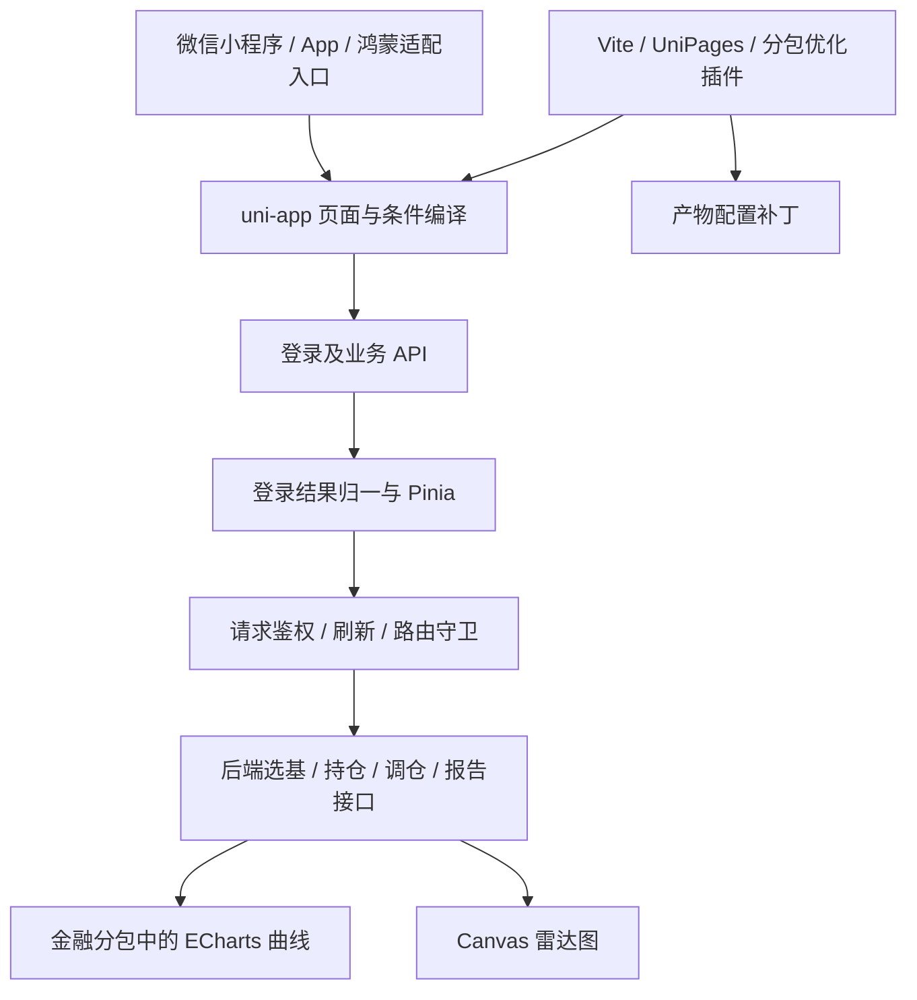

# 项目档案 · 钱抓抓 AI 理财前端

> 用途：围绕简历中的四点工作内容，准备前端 / 跨端应用面试。
> 核对日期：**2026-10-20（Asia/Shanghai）**；依据当前下载的源码快照，不以 Git 提交历史推断开发过程。
> 项目来源：用户说明源码直接从 Gitee 下载；本地虽有 `.git`，当前源码显示为未跟踪文件，无法据此还原原仓库提交和个人贡献。
> 证据口径：源码证明“当前有怎样的实现”，不能独立证明“由谁完成、何时完成、上线效果如何”。本次只新增文档，不修改业务代码。

## 阅读方式

结构参照 Fitness 项目档案：**20～30 秒回答 → 事实卡 → 提问方向地图 → 逐问预答 → 准备动作清单 → 踩坑记录 → 实现细节 → 源码入口**。四点与简历截图保持一致：

1. [跨端四端交付](#point-1)：uni-app、条件编译、平台能力和工程配置。
2. [多端登录与鉴权](#point-2)：微信 / 华为 / 手机号、双 token、并发刷新、路由守卫。
3. [金融图表可视化](#point-3)：ECharts、Canvas 雷达图、曲线错位和切换后的绘制。
4. [小程序分包与性能优化](#point-4)：双分包、预加载、跨包组件占位、构建补丁。

本档案中的回答以“项目当前实现”为主。只有确认属于自己负责的内容，面试时才改成“我设计 / 我实现 / 我修复”。**缺少提交记录不等于没有做过，也不意味着可以把整个下载仓库都算作个人工作。** 可以用实际负责的页面、需求单、交付包和演示补充贡献证据。

“实现型问题”表示源码和注释支持问题与处理方式；“待验证风险”表示静态阅读发现的边界，不能包装成已经发生或已经解决的事故。

## 项目描述与当前实现

**简历核心功能**：一键 AI 选基金 / ETF / 理财、持仓导入、AI 调仓与多维报告，旨在提升理财信息获取与选择效率。

**项目定位**：钱抓抓的 uni-app 前端工程，承接用户输入、登录、持仓及组合业务流程、后端接口调用和金融数据展示。当前仓库没有提供后端模型服务源码，不能据此前端接口名称声称独立开发了选基模型、调仓算法或后端 MQ。

**面试开场，约 40 秒**：

> 这是一个 AI 理财产品的跨端前端项目，主要功能是选基金和 ETF、导入持仓、查看组合报告和调仓结果。技术上用 uni-app、Vue 3 和 Pinia，图表用 ECharts 和自绘 Canvas。项目里比较值得展开的四块是平台差异处理、多入口登录及 token 刷新、金融曲线的跨端绘制，以及小程序分包。我的具体负责范围是【补充真实模块和交付内容】；下面可以选一块讲实现。

### 技术栈核对

| 层次 | 当前源码口径 | 证据 |
| --- | --- | --- |
| 框架 | uni-app `3.0.0-4070620250821001` 系列依赖，Vue `^3.4.21` | [package.json](../package.json) |
| 语言与构建 | TypeScript `~5.8.0`、Vite `5.2.8`；业务中仍有较多 JS 和 Options API | [package.json](../package.json)、[Vite 配置](../vite.config.ts) |
| 状态 | Pinia `2.0.36`、持久化插件 `3.2.1`，token / user 分开管理 | [store](../src/store/index.ts)、[token](../src/store/token.ts) |
| 样式 | UnoCSS `66.0.0`、SCSS、rpx，项目同时有大量局部样式 | [UnoCSS 配置](../uno.config.ts) |
| 图表 | ECharts 依赖 `^5.4.1`、lime-echart 适配、自绘雷达图；小程序另引分包内压缩包 | [曲线组件](../src/pages-finance/components/fund-chart-container-echart/fund-chart-container-echart.vue) |
| 工程基础 | 带 unibest 模板元信息及 uni-helper 插件，不能把模板全部说成自研 | [package.json](../package.json) |
| 测试 | Vitest `3.2.4`、Vue Test Utils、jsdom；有 4 个测试文件 | [Vitest 配置](../vitest.config.ts) |

以上版本是清单声明，带 `^` / `~` 的不是本次运行时实测版本。未安装依赖，也未验证各平台编译工具版本。

### 四点在系统中的位置



业务 API 大量使用 `src/utils/request.js`；另有 `src/http/http.ts` 请求封装。二者会经过已安装的 `uni.request` 拦截器，但**各自维护刷新协调状态**。

## 简历四点与核对结论

| 简历原句 | 核对结论与回答边界 |
| --- | --- |
| ① 跨端四端交付：基于 uni-app 一套代码交付微信小程序 / App / 鸿蒙 App，用条件编译收敛端差异 | 有微信、Android / iOS 构建脚本、鸿蒙配置和平台分支。若“四端”指微信小程序、Android、iOS、鸿蒙，需你确认；源码还有 H5，但不能据此代替交付证明 |
| ② 多端登录与鉴权体系：实现微信 / 华为 / 手机号多端登录与双 token 自动刷新鉴权体系，路由守卫 | 存在对应入口、接口和双 token 实现。只有后端实际返回 refreshToken 才能刷新；两套请求封装不能合称全应用全局单次刷新 |
| ③ 金融图表可视化：封装跨端 ECharts 基金走势图与自研 canvas 雷达图，解决榜单曲线插值与标签溢出问题 | 可核实曲线、采样、特殊点、雷达绘制和标签位置处理；“榜单曲线插值”需要具体旧现象或数据案例，不能把 `smooth: true` 或等距采样直接叫插值算法修复 |
| ④ 小程序分包与性能优化：主导微信小程序双分包改造，Vite 插件修复分包配置丢失，降低主包体积、优化冷启动 | 可核实两个分包、预加载、占位、补丁插件。“主导”属于个人贡献待确认；减小主包和改善冷启动是设计目标，尚无前后测量值 |

**更贴近现有证据的表述，供核对个人贡献后使用：**

- 跨端适配：基于 uni-app 维护微信小程序与 App 页面，通过条件编译、原生能力封装和平台配置处理登录及图表差异。
- 登录鉴权：接入微信、华为及手机号登录，统一登录结果和持久化状态，实现业务请求双 token 刷新、排队重放及多入口路由校验。
- 金融图表：封装 ECharts 走势组件与 Canvas 雷达图，处理长序列采样、关键日期标记、切换重绘与交互标签边界。
- 分包工程：将金融与账户页面拆为两个分包，配置预加载和跨包组件占位，通过 Vite 产物补丁补齐相关配置，为主包和首屏优化提供基础。

若已有真实四端交付或性能测量，补回具体端和结果即可，不必为了谨慎删除已发生的工作。

## 面试深挖预案

| 简历点 | 主问题 | 第一层回答 | 适合展开的例子 |
| --- | --- | --- | --- |
| 跨端 | 一套代码是不是到处直接运行？ | 业务共享，授权、图表引入和构建配置按平台处理 | 小程序 UMD 与 App / H5 ESM 图表入口 |
| 鉴权 | 多个请求同时过期怎么办？ | 主业务封装共享刷新 Promise，成功后限并发重放 | 3 路重放、一次重试、旧 token 兼容 |
| 图表 | 为什么换时间范围后图不对？ | 同时检查数据、坐标与 Canvas 实例状态 | 重建实例、统一采样索引、保留关键日期 |
| 分包 | 配了分包为什么还要写插件？ | 源配置和最终 app.json / 页面 JSON 要同时核对 | closeBundle 补预加载和组件占位 |

讲述顺序：**用户操作 → 技术问题 → 当前处理 → 验证办法 → 剩余边界**。

<a id="point-1"></a>

## 要点① 深挖手册 · 跨端四端交付

> 简历原句：基于 uni-app 一套代码交付微信小程序 / App / 鸿蒙 App，用条件编译收敛端差异。
> 大白话：尽量共用页面和业务逻辑，把无法共用的平台能力单独处理。

### 20～30 秒回答

> 项目用 uni-app 共用页面和业务逻辑，但授权能力、图表加载方式和原生配置仍要区分平台。例如小程序走势图引用金融分包里的 ECharts 压缩包，App 和 H5 用 ESM 依赖；登录则把平台授权结果交给后端换成统一的业务会话。

### 事实卡（现在做到了什么）

| 环节 | 当前实现 | 回答时注意 |
| --- | --- | --- |
| 共享基础 | Vue 页面、业务 API、Pinia、样式和通用组件 | 有条件编译不代表全部交互完全一致 |
| 编译入口 | 微信、H5、App、Android、iOS 等 scripts | scripts 存在不等于打包或上架成功 |
| 鸿蒙 | manifest 有 `app-harmony` 配置，登录使用 huawei provider | 依赖、配置、授权函数和实际设备交付要分别证明 |
| 图表引入 | `MP` 分支 require 分包内 ECharts；非 MP import ECharts | 不能把所有端都说成同一个浏览器 DOM 环境 |
| 请求适配 | 非微信分支设置 responseType；H5 可走开发代理 | 开发代理不是手机端请求链路 |
| 原生资源 | 构建插件可复制 nativeplugins，并有 manifest 同步插件 | 不等于已验证每个平台原生插件完整可用 |

### 提问方向地图

| 方向 | 面试官关注 | 问题 |
| --- | --- | --- |
| 选型 | 复用范围与成本 | A1～A2 |
| 平台差异 | 条件编译、授权、图表 | B1～B3 |
| 交付 | 四端范围、验证证据 | C1～C3 |

### 逐问预答

**A1. 为什么用 uni-app？**

> 产品要覆盖小程序和 App，页面与业务流程相似，共用 Vue 技术栈能减少重复维护。代价是要处理平台能力、组件和构建差异。这里没有做过完整竞品框架性能对比，不用“性能最优”解释选型。

**A2. 一套代码具体复用了什么？**

> 主要是页面业务、接口参数、登录结果处理和用户状态。平台提供的授权能力、图表加载方式、打包权限和资源配置需要单独适配。复用不是只写一次之后完全不测其他端。

**B1. 条件编译和运行时判断有什么区别？**

> 条件编译决定当前平台产物包含哪些代码，运行时判断决定已经进入产物的代码走哪个分支。项目里图表模块的不同引入方式用条件编译；同一运行环境中的状态分支仍由普通逻辑处理。

**B2. 给一个具体的端差异例子？**

> 基金图表在小程序分支 require 金融分包中的压缩构建，非小程序分支使用 import。上层继续使用 lime-echart 初始化图表。这样模块入口适配可以集中处理，但 Canvas 和触摸交互仍要分别验收。

**B3. 华为登录为什么不是直接复用微信登录？**

> 平台 provider 和后端交换接口不同。华为链路先取得授权 code，经后端换 harmonyOpenId，再登录；微信有自己的接口。最终都进入统一登录成功处理，平台差异在前半段，会话状态在后半段收敛。

**C1. 简历里的“四端”具体是哪四个？**

> 这需要按实际交付清单回答。若指微信小程序、Android、iOS、鸿蒙，要列出各自验证设备或包；仓库额外支持 H5 入口，不代表 H5 也是已经交付的正式产品。不要把 App 一会儿算一个端、一会儿算两个端。

**C2. 怎么验证跨端不是“只编译成功”？**

> 用相同业务用例分别走登录、导入、报告、图表切换和退出；检查首次进入、后台恢复和授权取消。构建成功只说明产物生成，还需要开发者工具或真机确认原生能力和绘制结果。

**C3. 你有没有独立做后端 AI？**

> 当前能展示的是前端调用选基、组合及报告接口的工作。接口里存在 MQ 版本和查询结果入口，但这个仓库没有后端实现，不能把这些接口名当作我开发模型或消息队列的证据。

### 准备动作清单

1. 补一张真实交付表：平台、系统版本、验证设备、负责模块、交付形式。
2. 能现场指出一个条件编译块，解释它隔离的是哪一种平台差异。
3. 将模板基础与自己的业务改动分开讲，明确 unibest、lime-echart 的来源。
4. 准备相同业务路径在两个端的演示，记录不一致之处及实际处理。

### 踩坑记录（问题 → 原因 → 修改 → 验证）

#### 问题 1：同一图表库的模块入口不能直接假定跨端一致（实现型问题）

**问题与原因**：小程序的分包组织、模块加载方式和 App / H5 的构建路径不同。

**当前处理**：曲线组件通过 `MP` 条件编译选择分包内压缩包，其他平台走 ESM。业务图表仍由相同组件组织。

**可讲话术**：

> 复用业务组件时，我会先区分“图表配置能复用”和“模块加载环境相同”。当前工程按平台选择入口，避免在业务页面各写一套图表配置。需要注意的是，这只能解释当前设计，原来是哪一台设备报什么错，还要用我的实际经历补充。

**验证**：源码已核对；本次没有运行多端构建。演示时检查微信分包路径及 App 图表首帧。

#### 问题 2：原生资源和插件配置不只是 Vue 文件（实现型问题）

**当前处理**：`copy-native-resources` 在启用时复制原生资源；`sync-manifest` 在构建后同步插件字段。

**边界**：manifest 同步插件目前固定写 `dist/dev/app/manifest.json`，不能说它已普遍覆盖生产和鸿蒙产物。应按目标构建目录核对。这是当前实现边界，不是本次已修复事项。

### 实现细节：从平台能力到共享业务

```text
平台构建目标
  → 条件编译选择可用代码 / 配置
  → 页面调用平台授权或图表适配能力
  → 授权结果交给后端，业务响应归一
  → 共用 Pinia、业务页面和报告展示
```

### 源码与演示入口

- [package.json](../package.json)、[manifest.config.ts](../manifest.config.ts)：构建入口及平台配置。
- [login.js](../src/utils/login.js)：平台授权与绑定流程。
- [曲线组件](../src/pages-finance/components/fund-chart-container-echart/fund-chart-container-echart.vue)：图表平台分支。
- [复制原生资源](../vite-plugins/copy-native-resources.ts)、[manifest 同步](../vite-plugins/sync-manifest-plugins.ts)。

<a id="point-2"></a>

## 要点② 深挖手册 · 多端登录与鉴权体系

> 简历原句：实现微信 / 华为 / 手机号多端登录与双 token 自动刷新鉴权体系，路由守卫。
> 大白话：不同方式登录后统一保存会话，短期凭证失效时尝试续期，不能续期再回到登录页。

### 20～30 秒回答

> 登录入口有微信、华为和手机号，成功后统一归一 token 并写入 Pinia。主业务请求层在 token 可刷新时复用一次刷新任务，把失败请求排队，刷新成功后按三路并发重放，每个请求最多自动重试一次。页面跳转和应用显示入口也会校验登录状态。

### 事实卡（现在做到了什么）

| 环节 | 当前实现 | 边界 |
| --- | --- | --- |
| 登录结果 | `normalizeAuthTokens` 接受字符串、字段别名和嵌套 data | 是兼容归一，不是完整运行时 schema 校验 |
| 模式 | `.env` 配置 `VITE_AUTH_MODE = 'double'` | 必须实际拿到 refreshToken 才能续期 |
| 旧接口 | 纯字符串写成 accessToken，缺省过期时间按 365 天 | 这是本地兼容假设，不是服务端承诺 |
| 持久化 | store 使用 `auth-session`；兼容 `token`、`authRefreshToken` 键 | 没有安全硬件存储实现的证据 |
| 主请求封装 | `refreshTask` 共享刷新，`pendingQueue` 收集失败请求 | 主要业务 API 使用此封装 |
| 重放 | `REPLAY_CONCURRENCY = 3`，`_authRetried` 限制重试 | 单批队列的限流，不是所有网络请求全局限流 |
| 触发 | 发请求前可续期，响应业务码 `401` 可刷新 | 主封装没有同时判定 `res.statusCode === 401` |
| 另一请求封装 | `http.ts` 同时检查 HTTP / 业务 401，维护独立队列 | 不与主封装共用刷新锁；队列重放用 forEach |
| 刷新接口 | `/prod-api/refreshToken`，直接调用 uni.request | 绕开业务刷新递归，但仍受全局 request 拦截器影响 |
| 路由策略 | 默认公开，精确保护个人数据、生成结果及导入子页 | 前端路由校验不是服务端权限验证 |
| 入口覆盖 | 路由 API、navigateBack、App onShow、H5 router | 代码存在不等于所有冷启动时序都已实测 |

### 提问方向地图

| 方向 | 面试官关注 | 问题 |
| --- | --- | --- |
| 登录 | 多入口与统一状态 | A1～A3 |
| 刷新 | 并发、重试、失败 | B1～B5 |
| 路由 | 直接进入与游客 | C1～C3 |
| 完善 | 现有缺口 | D1 |

### 逐问预答

**A1. 微信登录得到的 code 就是业务 token 吗？**

> 不是。code 是平台授权交换材料，要交给后端换成业务会话。前端最终保存的是业务 accessToken 等字段，不能直接拿平台 code 当后续接口凭证。

**A2. 华为链路具体怎么走？**

> `uni.login` 使用 huawei provider，取得 code 后调用后端 codeToOpenid，再用 harmonyOpenId 登录。已有账号进入统一登录结果处理；需要绑定的情况进入带 provider 信息的绑定流程。

**A3. 为什么要兼容字符串 token？**

> 项目同时存在旧登录接口和双 token 状态结构。归一层把旧响应写成 accessToken，避免页面各自识别字段。但没有 refreshToken 时只能重新登录，不能声称旧接口也支持无感续期。

**B1. 十个请求同时 401 会刷新十次吗？**

> 在主业务封装的同一轮刷新期间，后续请求复用 `refreshTask`，失败请求进入队列。成功后按三路并发发送。这个保证只覆盖该协调器；另一个 http 封装以及直接调用 store 刷新的路径没有共用它。

**B2. 为什么成功后不一次全部发出去？**

> 登录恢复后多个请求集中重放可能产生瞬时压力，所以队列用 active 计数限制为三路，一条完成再补下一条。三是当前配置值，没有压测证明它是最优值，也不能当作平台并发上限。

**B3. 刷新接口自己再返回 401，会不会循环？**

> 刷新函数直接使用底层请求，不进入主业务封装的 401 队列；业务重放还会带 `_authRetried`，防止同一请求无限续期。另一套 http 封装使用 `skipTokenRefresh` 限制重试。

**B4. 刷新失败怎么处理？**

> 主封装拒绝等待队列，清除本地 token 和用户信息，再引导登录。队列不能只清空不 reject，否则调用方会一直等待。当前仍有细节待完善，例如主封装的登录跳转标记没有在这里复位，应验证同一应用生命周期第二次失效能否正常跳转。

**B5. 自动重放 POST 会重复提交吗？**

> 只有后端明确在鉴权失败时没有执行业务，重放才容易保证安全。前端没有通用幂等键机制，不能声称所有创建类接口都天然幂等。对于可能已经执行但响应丢失的情况，需要后端幂等能力配合。

**C1. 为什么有路由拦截，还要在 App onShow 检查？**

> 点击跳转会经过路由 API，但扫码、分享、启动参数或直接进入页面不一定走同一调用。onShow 补入口检查，H5 还安装 Vue Router 守卫，返回页面也有 navigateBack 校验。

**C2. 未登录是不是所有页面都拦？**

> 当前采用默认公开、按需保护。游客可以浏览部分页面，涉及用户持仓、收藏、生成结果或导入子页才要求登录。这样既保留体验入口，也避免用户误入个人业务流程。

**C3. 路由守卫怎样避免重复导航？**

> 普通导航拦截遇到私有页面时，直接改当前调用的目标为登录页，而不是同时发起第二次导航；返回和 onShow 场景另用重定向。当前普通分支没有统一改成 reLaunch，不能说所有拦截都会清空页面栈。

**D1. 如果继续完善鉴权，优先改什么？**

> 合并两套刷新协调状态，统一 HTTP 和业务 401 的判断，再补刷新失败、并发重放、旧会话返回和重复登录失效的测试。当前没有会话代次隔离，刷新结果与退出登录竞态也应单独验证。

### 准备动作清单

1. 手画 accessToken 与 refreshToken 的用途，解释后端才是最终鉴权方。
2. 准备并发业务 401、刷新失败、重放再 401 三种 mock 场景。
3. 对比两套 request 的返回结构、401 判断和刷新锁，避免背成一套统一实现。
4. 准备“旧接口只有字符串 token”的实际响应结构，去除真实凭证。

### 踩坑记录（问题 → 原因 → 修改 → 验证）

#### 问题 1：并发过期请求集中刷新（实现型问题）

**原因**：每个业务请求独立处理 401，会在同一时间触发多个续期请求。

**当前处理**：主业务封装共享 `refreshTask`，等待请求入队，成功后分三路重放，失败时统一拒绝。

**验证方法**：模拟多个业务 401，断言刷新调用次数、队列最终完成情况、重放最大并发以及失败不悬挂。本次只读代码，未执行这些测试。

#### 问题 2：持久化对象与旧字符串 token 共用键（实现型问题）

**原因与处理**：旧业务用 `token` 存字符串，Pinia 需要保存结构化会话。当前将 store 持久化键设为 `auth-session`，refreshToken 另存 `authRefreshToken`，并提供旧存储恢复逻辑。

**可讲话术**：

> 兼容旧登录时要先区分存储数据类型。旧代码读的是字符串，状态库保存的是对象，混用同一个键就可能互相覆盖。当前把两类存储分开，并在启动时做同步。过期时间的兼容默认值仍需要和后端约定核对。

#### 问题 3：路由拦截中再发起导航（实现型问题）

**当前处理**：源码注释明确提示并发 navigateTo 和 reLaunch 可能造成 timeout，所以普通拦截改写 `options.url`，复用当前导航。

**验证方法**：游客点击私有页、登录页重复进入、退出后返回、分享直达都要分别测试；不能仅凭一个跳转成功证明全部入口正确。

### 实现细节：主业务请求的时间线

```text
request → ensureAccessToken
  ├─ access 有效 → 带 Bearer 发送
  └─ access 失效且 refresh 可用 → 复用 beginRefresh 后发送

响应 body.code = 401
  ├─ 允许刷新且未重试 → 入 pendingQueue → 复用 beginRefresh
  │   ├─ 成功 → 保存新 token → 三路并发重放，标记 _authRetried
  │   └─ 失败 → reject 等待请求 → 清会话 → 登录页
  └─ 不可刷新 → reject；按已有登录状态处理清理和跳转
```

注意：主封装会直接 resolve 其他响应体；`http.ts` 则检查业务成功码并解出 data，两个封装的返回契约也不同。

### 源码与演示入口

- [平台登录](../src/utils/login.js)、[业务登录 API](../src/api/legacy-login.js)。
- [统一登录成功处理](../src/utils/auth.ts)、[token 归一和续期 API](../src/utils/authToken.ts)、[token store](../src/store/token.ts)。
- [主业务 request](../src/utils/request.js)、[另一 http 封装](../src/http/http.ts)、[底层拦截器](../src/http/interceptor.ts)。
- [路由拦截](../src/router/interceptor.ts)、[H5 守卫](../src/router/permission.ts)、[App 生命周期](../src/App.vue)。

<a id="point-3"></a>

## 要点③ 深挖手册 · 金融图表可视化

> 简历原句：封装跨端 ECharts 基金走势图与自研 canvas 雷达图，解决榜单曲线插值与标签溢出问题。
> 大白话：把后端的时间序列和维度分数画出来，切换数据、触摸查看和小屏展示时保持正确。

### 20～30 秒回答

> 走势图通过 lime-echart 适配 ECharts，处理时间范围、基准对比和关键日期标记。长序列用同一组索引采样各条曲线，并额外保留峰值、低点和调仓日；切换时重建实例并关闭更新动画。雷达图用 Canvas 自绘网格、数据区域和标签。

### 事实卡（现在做到了什么）

| 环节 | 当前实现 | 边界 |
| --- | --- | --- |
| 图表就绪 | finished 事件触发 init，初始化标记避免重复调用，等待容器 | 固定延迟只是适配措施，不保证任意设备就绪 |
| 切换重绘 | dispose → 等待 80ms → init → setOption | 更偏正确性兜底，有重建成本 |
| 更新合并 | isChartUpdating + pendingChartUpdate | 防重叠更新，不等于接口响应具备乱序保护 |
| 动画 | 首次 300ms，更新动画时长 0 | 不能说彻底关闭了所有动画 |
| 长序列 | 超过 500 点时等步长采样，各序列共享索引 | 加入关键点后最终数量可能超过 500 |
| 关键点 | 保留末点、prevPeakDate、minYieldDate、调仓日期 | 不是自动保留所有局部极值的算法 |
| 标记 | 特殊点采用 markPoint 类目坐标 | 交互十字线仍有 convertToPixel 路径 |
| 标签 | 依据容器边缘调整十字线标签位置 | 标签宽高部分使用估值，不是全面文字测量 |
| 雷达图 | createCanvasContext；rpx 换 px；网格、面、点、标签 | 采用旧版 Canvas API，无单独 DPR backing store 处理的证据 |
| 雷达值 | 按 value / 100 计算半径 | 未见完整 clamp；非法或超范围数据应验证 |

### 提问方向地图

| 方向 | 面试官关注 | 问题 |
| --- | --- | --- |
| 生命周期 | 什么时候能画、切换如何更新 | A1～A3 |
| 数据正确性 | 采样、插值、标记索引 | B1～B4 |
| Canvas | 坐标与标签 | C1～C3 |
| 验证 | 用什么证明修复 | D1 |

### 逐问预答

**A1. 为什么不直接在 mounted 里初始化 ECharts？**

> 页面挂载不代表底层 Canvas 和容器尺寸都可用。当前组件等 lime-echart 的 finished，再等容器并初始化；数据可能先回来，所以初始化后也检查是否已有数据需要渲染。

**A2. 切换曲线为什么重建实例，不只 setOption？**

> 当前代码针对跨端 Canvas 旧帧残留使用了重建路径，保证实例状态和新数据一起更新；同时 notMerge 避免旧配置残留。这有额外成本，不能称为高性能局部更新。进一步优化应先定位哪些端必须重建。

**A3. 多次切换会同时创建多个实例吗？**

> updateChart 用更新中标记挡住重叠执行，再记录一次待更新，当前轮结束后继续处理。不过这只管理绘制阶段，不能证明请求 A、B 乱序返回时一定展示用户最后选择，需要额外的请求版本检查。

**B1. 为什么采样时要让所有曲线使用同一组索引？**

> 横轴日期和各条收益序列一一对应。如果各自抽样，某个索引可能在不同曲线代表不同日期，比较和触摸数值就会错。当前先生成并排序索引，再统一映射 categories 和各个 series。

**B2. 每隔几个点取一个，为什么还要保留特殊日期？**

> 回撤起止点、调仓日可能刚好被跳过，标记会丢失或错位。当前把关键日期索引加入 Set，排序后一起采样。这里是业务关键点保留，不是 LTTB，也不是完整峰谷保持。

**B3. 简历里“插值”具体是指什么？**

> 需要回到真实问题确认。平滑曲线、缺失值补齐、时间轴对齐和采样是不同概念。当前能清楚证明的是采样、日期归一、标记和更新动画处理；没有旧数据案例时，我会把简历写成这些可解释的具体工作。

**B4. 为什么特殊点改用 markPoint？**

> 手工叠加点需要将数据坐标转换为像素，遇到采样或跨端 Canvas 状态不同容易错位。markPoint 跟随 ECharts 的坐标系，当前按日期类目和数据值定位。但十字线仍使用像素转换，不能说整个组件完全移除了坐标换算。

**C1. 雷达图一个维度的坐标怎么算？**

> 先把分数除以 100 映射成半径比例，再按维度数均分圆周。角度是 `2πi/n - π/2`，坐标是中心加 `r*cos(angle)` 和 `r*sin(angle)`。相邻点连接成数据区域，最后单独绘制标签和点。

**C2. rpx 怎么转换成 Canvas 坐标？**

> 当前用 windowWidth / 750 得到比例，把组件的 rpx 宽高换成绘制尺寸。这个比例与设备像素比不是一回事，所以不能说这一步就完成了高分屏像素缓冲适配。

**C3. 标签溢出怎么处理？**

> 曲线交互标签会按接近左右边缘的位置改变对齐方式，接近上下边缘时调整显示方向。它依赖估算的标签大小，所以超长文字、小屏、横屏仍需要测。雷达图的文字绘制逻辑要单独看，不能把一个组件的处理概括成所有标签自动避让。

**D1. 怎么验证不是“看上去差不多”？**

> 用有明确日期和值的小数据核对点位；再用超过 500 点的数据验证关键日期是否保留。切换时同时检查曲线、坐标、十字线数值和标记，不只看是否出现折线；在目标端分别跑。

### 准备动作清单

1. 准备 5 点手算数据、长序列、包含峰谷和调仓日的数据。
2. 能解释“数据值 → 日期索引 → 坐标 → 触摸显示”的转换。
3. 将“插值修复”的旧截图、错误输入、处理代码补齐；拿不出时使用校准后的表述。
4. 演示反复切换范围、小屏边缘触摸、空数据恢复及页面销毁重入。

### 踩坑记录（问题 → 原因 → 修改 → 验证）

#### 问题 1：坐标系更新了，画面仍像旧数据（实现型问题）

**源码依据**：option 注释描述小程序 Canvas 旧帧、十字线偏离曲线；更新路径重建实例并把更新动画设为零。

**当前处理**：串行执行销毁与重建，完整设置新 option，同时保留首帧动画。

**可讲话术**：

> 遇到曲线和十字线对不上的情况，不能只查接口数据，还要核对图表坐标系与实际 Canvas 帧是否一致。当前实现通过重建实例和关闭更新动画做兼容处理，代价是切换时更重。是否还能保留实例，需要分平台验证后再优化。

**验证**：本次核对源码和注释，没有真机复现记录；不补写故障时间、设备或耗时。

#### 问题 2：采样以后关键标记找不到了（实现型问题）

**原因**：标记使用原始日期，等距采样可能删除该日期；若用原始索引套进采样后的序列，也会错位。

**当前处理**：采样前把关键日期加入索引集合，类目和序列同步映射，特殊点按最终类目定位。

**边界**：日期匹配找不到时会寻找第一个不小于目标的日期，依赖日期顺序和可比较格式；它不是任意乱序数据的自动纠错。

#### 问题 3：雷达数据从有值变为空值可能保留旧画面（待验证风险）

`drawRadar` 在 categories 为空时直接返回，清屏在该判断之后；因此“已有画面 → 空数据”需要单独验证。当前没有把它写成已修复问题。

### 实现细节：绘制链路

```text
接口时间序列 → chartData
  → 日期归一 / 共享采样索引 / 保留关键点
  → 生成 xAxis、series、markPoint 等 option
  → 更新互斥 → dispose → 等待 → init → setOption
  → 完成本轮，若有 pending 再更新

雷达维度数据 → rpx 换 px → 确定中心与半径
  → 网格 → 数据面和线 → 数据点 → 标签 → ctx.draw
```

### 源码与演示入口

- [走势图组件](../src/pages-finance/components/fund-chart-container-echart/fund-chart-container-echart.vue)：重点看 initChart、updateChart、getEchartOption、adjustLabelPosition。
- [Canvas 雷达图](../src/components/custom-radar/custom-radar.vue)：initCanvas、drawRadar 及坐标计算。
- [lime-echart 适配层](../src/uni_modules/lime-echart/components/l-echart/l-echart.vue)：第三方基础，区别于业务封装。
- [报告 API](../src/api/report.js)、[组合 API](../src/api/ai.js)。

<a id="point-4"></a>

## 要点④ 深挖手册 · 小程序分包与性能优化

> 简历原句：主导微信小程序双分包改造（分包预加载、跨包组件占位、异步跨包调用），Vite 插件修复分包配置丢失，降低主包体积、优化冷启动。
> 大白话：把非首屏业务和重图表放到分包，提前准备可能用到的包，保证跨包组件加载及最终配置正确。

### 20～30 秒回答

> 当前工程把金融业务和账户业务拆成两个分包，金融图表与小程序 ECharts 资源也放在金融包。主包保存页会预加载金融包，并给跨包图表配置 view 占位。构建结束后再补写 app.json 和页面 JSON，避免源配置没有落到产物；性能收益还需要前后数据证明。

### 事实卡（现在做到了什么）

| 环节 | 当前实现 | 边界 |
| --- | --- | --- |
| 双分包 | UniPages 注册 pages-finance、pages-account | 这是普通分包，未据此认定独立分包 |
| 插件 | UniOptimization 仅微信端启用，位于 UniPages 之后 | 插件支持能力不等于业务每一种能力均已验收 |
| 图表归属 | 金融组件和小程序 ECharts 压缩包位于金融分包 | 主包仍有 shared 组件和资源，需检查产物依赖图 |
| 主包使用 | 保存页引用金融分包图表组件 | 需要跨包加载与占位配置配合 |
| 预加载 | 保存页 preloadRule：network all，packages pages-finance | 进入保存页触发规则，不是应用启动立即加载所有包 |
| 占位 | `fund-chart-container-echart: view` | 占位保证等待期间有替代组件，不等于业务错误兜底 |
| 产物补丁 | closeBundle，微信目标，修改两个 JSON | 两个文件都存在才执行，否则直接返回 |
| 输出路径 | 按 NODE_ENV 选择 dist/build 或 dist/dev | 不是根据所有自定义 mode 自动推导任意目录 |
| 测量 | 本次无前后包体、首屏耗时、设备测量 | 不填写百分比、MB 或冷启动秒数 |

### 提问方向地图

| 方向 | 面试官关注 | 问题 |
| --- | --- | --- |
| 拆分 | 如何选择边界 | A1～A2 |
| 加载 | 预加载、占位、异步 | B1～B3 |
| 构建 | 插件时机、配置丢失 | C1～C3 |
| 性能 | 收益和验证 | D1～D2 |

### 逐问预答

**A1. 为什么按金融和账户拆？**

> 金融报告、图表、调仓是一组相关功能，登录、资料和导入子流程又是另一组。按业务聚合能让页面和重依赖一起移动，避免只挪页面文件却仍把大库留在主包。当前具体边界以 UniPages 的两个目录为准。

**A2. 是不是把文件移到分包目录就完成优化？**

> 不是，还要看编译后依赖放在哪里、主包是否直接拉入重资源，以及页面路由和组件引用是否正确。必须检查实际 app.json、页面 usingComponents 和包体归属，源码目录只是第一步。

**B1. 分包预加载解决什么？**

> 延后加载能减轻首屏必需内容，但首次进入分包会增加等待。预加载利用用户停留在相关入口的时间提前准备。这里在保存页预加载金融包，不应说成所有用户启动时都预加载两个包。

**B2. 为什么跨包组件要占位？**

> 目标组件对应的包可能还没准备好，先用 view 占位，让页面有可用的替代节点；加载完成后使用真实组件。占位本身不提供失败重试或完整 loading UX，这些还要业务层设计。

**B3. “异步跨包调用”是自己写的运行时吗？**

> 当前工程接入 bundle-optimizer，配置注释说明其模块和组件异步跨包能力。可展示的业务例子是主包保存页引用金融分包图表。不能把依赖插件提供的运行时说成全部自研，也不能在没检查产物前声称任意 JS 跨包调用都已验证。

**C1. 为什么选 closeBundle 修补？**

> 要修的是最终写出的 JSON，等构建结束后能直接检查产物是否包含预加载和占位字段。若仅修改源配置，后续生成步骤仍可能覆盖。当前插件在 closeBundle 读取、修改并写回文件。

**C2. 补丁具体补什么？**

> app.json 写保存页对应的 preloadRule；保存页 JSON 写图表组件的 componentPlaceholder。不负责重新划分目录，也不负责把全部依赖自动搬进分包。

**C3. 这个插件有什么局限？**

> 路径和两个对象目前硬编码，采用整体赋值，未来新增其他预加载或占位条目可能被覆盖；目标文件不存在会静默跳过。更稳的方向是合并已有字段，并对缺失产物给出明确诊断，但本次没有修改这些代码。

**D1. 主包小了，冷启动一定更快吗？**

> 主包内容减少可能降低首次下载和解析负担，但冷启动还受缓存、网络、设备、首屏接口和渲染影响。预加载也可能增加后续网络占用，所以需要固定条件测量，不能把源码分包直接等同于冷启动提升。

**D2. 怎么补一份可信的性能证据？**

> 用同设备、同工具版本、同网络和同数据比较两个可复现构建。记录主包及各分包大小、首次进入可用时间和首次进入金融页等待。当前没有改造前版本，不应伪造历史基线；可以保留当前数据，作为后续改进的基线。

### 准备动作清单

1. 画出主包、金融包、账户包及跨包图表的关系。
2. 准备构建后 app.json、保存页 JSON 和包体分析截图。
3. 同时验证开发和生产输出目录，不只检查源 pages 配置。
4. 用真实基线补测结果；没有基线时把效果写成设计目标与已完成机制。

### 踩坑记录（问题 → 原因 → 修改 → 验证）

#### 问题 1：源码配置有了，生成 JSON 没有（实现型问题）

**源码依据**：补丁插件明确用于补齐编译后丢失的预加载和跨包组件占位配置；源 pages 配置和保存页也有相关声明。

**当前处理**：微信构建结束后对两个目标 JSON 做定点补写。

**可讲话术**：

> 排查分包不能停在“配置文件里已经写了”。最终运行的是生成后的 JSON，所以要把源配置与产物逐项对照。当前工程把必要字段放在构建完成后补齐，确保运行时能读到。究竟是哪次编译版本丢字段，需要原始复现记录才能进一步归因。

**验证**：本次核对插件实现，未重新构建；没有把历史 unpackage 目录视作本次产物证据。

#### 问题 2：主包页面需要分包图表（实现型问题）

**原因与处理**：图表放入金融包后，主包保存页仍需要使用它。当前通过组件映射、优化插件、预加载和占位协同处理。

**验证方法**：清缓存首次进入保存页，观察占位与真实图表替换；再检查直接进入报告页与返回主包。缓存命中时正常不代表首次加载也正常。

### 实现细节：构建到页面加载

```text
UniPages 注册页面和两个分包
  → 微信端 UniOptimization 处理分包相关依赖
  → uni 编译生成产物
  → closeBundle 补 app.json 的 preloadRule
                  补保存页 JSON 的 componentPlaceholder

进入保存页 → 匹配预加载规则 → 准备金融分包
  → 图表未就绪时占位 → 组件可用后显示图表
```

### 源码与演示入口

- [Vite 配置](../vite.config.ts)：subPackages、插件顺序和微信端开关。
- [pages 配置](../pages.config.ts)：组件映射与预加载。
- [主包保存页](../src/pages/import/save/save.vue)：跨包组件引用及占位声明。
- [产物补丁](../scripts/patch-mp-subpackage-config.ts)：closeBundle、输出目录、JSON 字段。

## 补充项目素材（被问到再展开）

| 素材 | 可以展开的范围 | 不扩大为 |
| --- | --- | --- |
| AI 业务 | 选基、ETF、理财、组合、调仓的前端参数与结果展示 | 自研模型、投资有效性或后端任务系统 |
| 持仓导入 | 导入 API 与页面流程，连接组合报告 | 未查看后端就断言 OCR、解析算法全为自研 |
| 接口工程 | 新旧请求封装、响应兼容、状态归一 | 全部接口统一强类型运行时校验 |
| 通用组件 | 底部导航、弹窗、报告标题、图表等 | 每个组件都是本人从零开发 |
| 测试基础 | 4 个现有测试文件，覆盖用户状态、请求 hook、防抖、TabbarItem | 已覆盖登录刷新、图表与分包核心回归 |

## 统一边界与待补信息

| 容易说过头的表述 | 当前建议口径 |
| --- | --- |
| 四端均上线 | 明确四端定义，并补各自交付和验收证据 |
| 所有 401 全局只刷新一次 | 主业务封装内共享刷新，另有独立 http 刷新状态 |
| 所有登录都支持双 token | 需要实际响应包含 refreshToken，旧字符串凭证不具备续期材料 |
| token 默认有效一年 | 缺省值是前端兼容策略，服务端可能提前失效 |
| 所有路由都 reLaunch 到登录 | 普通拦截改写当前目标，其他入口再使用重定向 |
| 图表最多 500 点 | 500 是采样触发阈值 / 目标规模，关键点追加后可能更多 |
| 采样就是插值修复 | 区分采样、平滑、补值和时间轴对齐 |
| 高频切换只做轻量增量更新 | 当前重建实例，使用更新互斥和待更新标记 |
| 已彻底解决所有图表错位和标签溢出 | 有针对性实现，仍需样本和多端验证 |
| 分包使冷启动提升若干百分比 | 有配置与代码，没有本次前后实测 |
| 写了插件就证明编译器有某个确定缺陷 | 当前有产物补丁，具体版本归因需要复现材料 |
| Git 里没有记录所以无法准备面试 | 可以按源码准备机制、演示和边界；个人历史另行补充 |

**需要你补充的个人信息，文档不代填：**

1. 项目时间、团队规模、职责边界；哪些页面或问题由你实际负责。
2. “四端”的确切名单，各端是开发适配、测试包交付还是正式发布。
3. 简历“榜单曲线插值”的具体输入、错误表现、处理文件和验证方式。
4. 分包改造前的包体或截图是否留存；若没有，不再追造历史数字。
5. 最熟悉的一次真实问题：怎样发现、怎样定位、改了哪里、谁或什么用例验证。

## 本次验证记录

| 项目 | 方法 | 结果与边界 |
| --- | --- | --- |
| 参考结构 | 阅读 Fitness 档案的结构、四类准备材料及证据口径 | 已按本项目四个简历点组织，没有复用其项目事实 |
| 源码核对 | package、Vite、平台配置、登录、token、请求、路由、图表、分包补丁 | 已核对上述实现；不是全仓代码审计 |
| 历史 | 检查当前工作区状态并采用用户的下载来源说明 | 不使用本地 Git 推断原开发历史和作者 |
| 测试文件 | 检查 Vitest 配置及 4 个 test.ts 文件 | 文件存在不等于执行通过；也不代表四个重点全覆盖 |
| 运行环境 | 检查根目录 node_modules | 不存在；本次未安装依赖，未执行测试、typecheck、lint 或构建 |
| 真机 / 后端 | 微信、Android、iOS、鸿蒙授权、真实续期接口、Canvas 交互 | 本次未运行，不声称完整端到端验收 |
| 性能 | 未发现本次可用的改造前后测量结果 | 不报告体积变化、延迟收益和用户规模 |

文档静态检查：四个要点均包含完整的八类准备章节，合计 **41 组逐问预答**；**39 个链接（含章节锚点）均可解析**。新增文件的 Git 空白检查未报告空白错误，仅提示 LF / CRLF 换行转换。上述检查不等同于业务测试。

## 面试前准备清单

1. **先讲熟四个短回答**：跨端边界、统一会话、图表正确性、分包产物。
2. **优先深入一条真实负责的链路**：从页面操作、函数、接口直到最终展示，能现场定位源码。
3. **讲清四组区别**：授权 code 与业务 token；请求刷新与路由校验；采样与插值；源配置与构建产物。
4. **准备四个演示**：多入口登录、并发刷新、图表切换和关键点、首次进入跨包图表。
5. **只记有证据的数字**：两个分包、主请求重放并发三、500 点采样阈值；连同边界一起说。
6. **没有提交记录时的回答**：“我保存的是从 Gitee 下载的源码，当前没有原始提交历史。我可以说明自己的实际负责范围，并结合代码、交付材料和现场演示解释实现。”
7. **将个人贡献占位补完再用于正式面试**，把未验证的优化方向与已经完成的工作分开。
